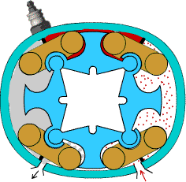
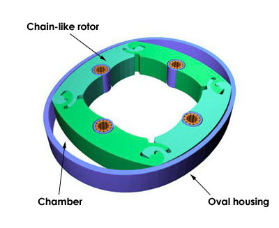

# Quasi Turbine Engine – Technical Seminar

### Rotary Engines | Thermodynamics | Advanced Propulsion Systems

**Acharya Institute of Technology | Department of Aeronautical Engineering**

---

## Overview

This technical seminar explores the Quasi Turbine Engine, an alternative rotary engine concept designed to overcome limitations associated with conventional piston and Wankel engines.

The study examines its working principle, articulated rotor mechanism, combustion characteristics, and potential applications in automotive, aerospace, and power generation systems.

  

  <em>Quasi Turbine Engine — Concept and Design</em>

  
  

---

## Technical Focus

- Working principle and construction of the Quasi Turbine Engine.
- Four-face articulated rotor and crankshaft-less rotary mechanism.
- Comparison with conventional piston and Wankel rotary engines.
- Homogeneous Charge Compression Ignition (HCCI) and photo-detonation concepts.
- Torque characteristics, vibration reduction, and multi-fuel compatibility.

---

## Engine Design Characteristics

| Feature | Description |
|---|---|
| Engine Type | Rotary Engine |
| Rotor Configuration | Four-Face Articulated Rotor |
| Housing Geometry | Near-Oval |
| Crankshaft | Not Required |
| Combustion | Four Power Strokes per Revolution |
| Design Objectives | Low Vibration, Continuous Torque |
| Fuel Compatibility | Multi-Fuel Potential |

---

## Engine Design Gallery

<table>
  <tr>
    <td align="center" width="50%">
      
       
      <b>Engine Concept & Design</b>
    </td>
    <td align="center" width="50%">
      
       
      <b>Engine Illustration</b>
    </td>
  </tr>
  <tr>
    <td align="center">
      
       
      <b>Rotary Engine Mechanism</b>
    </td>
    <td align="center">
      
       
      <b>Quasi Turbine Configuration</b>
    </td>
  </tr>
</table>

---

## Engineering Applications

- Automotive and motorsport propulsion
- Aerospace propulsion systems
- Pneumatic and hydraulic systems
- Hydrogen-based combustion systems
- Compact power generation

---

## Seminar Report & Presentation

| Document | Link |
|---|---|
| Complete Technical Seminar Report | [Read Report](./Report_Quasi-turbine_engine.pdf) |
| Seminar Presentation | [View PowerPoint](./Seminar%20PPT%20format.pptx) |

---

## Engineering Skills

- Thermodynamics & Internal Combustion Engines
- Rotary Engine Mechanisms
- Aerospace Propulsion
- Comparative Engine Analysis
- Technical Research & Documentation

---

## Author

**Anoop Subramanya**

Mechanical Engineer | Aerodynamics | Mechanical Design

- LinkedIn: www.linkedin.com/in/anoopsubramanya
- Email: anoopms2001@gmail.com

---

Academic technical seminar completed during undergraduate studies in Aeronautical Engineering at Acharya Institute of Technology.
